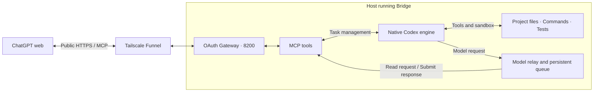

# ChatGPT MCP Bridge

[中文](README.md) · **v3 / 3.0.0** · [Version policy](docs/versioning.md)

Use the native Codex development engine through MCP from ChatGPT web to inspect code, edit files, run commands and execute tests in a configured workspace.

## Out of Codex usage? Continue some development work with ChatGPT web + MCP

If your Codex usage is temporarily exhausted and ChatGPT still provides the required model and MCP tools, this project offers another way to continue routine development:

- Read and edit code: explore project structure, understand implementations and make changes.
- Run commands and tests: execute scripts, investigate failures and verify fixes.
- Manage development tasks: inspect logs, processes, Git state and experiments.
- Continue longer tasks: use native planning, tool loops, history compaction, goals and task recovery.

ChatGPT produces model responses and tool calls. The native Codex engine manages tasks, executes tools and maintains development history. Bridge transports requests and responses through MCP. The engine is built from the Codex App Server/core source included in the repository.

Deploy Bridge on the host containing the projects you want to operate. The primary deployment documented here is macOS Apple Silicon with Conda, Tailscale Funnel and GitHub OAuth. Linux server deployment has also been tested; native Windows deployment is not supported.

This project does not add or restore Codex usage. Available capabilities depend on ChatGPT permissions, usage limits and deployment settings; full Codex product functionality and equivalent performance are not guaranteed.

## Runtime diagram



The main path runs left to right. The model relay listens on loopback and routes native model requests to ChatGPT through MCP.

1. ChatGPT calls start_agent and retains the thread_id.
2. Codex generates a model request.
3. ChatGPT calls next_model_request; read_model_request pages large contexts.
4. ChatGPT returns text or offered native tool calls with submit_model_response.
5. Codex executes calls, records results and continues.
6. ChatGPT services requests and checks get_agent_status until completion, pause or required user input.

Return native tool calls to Codex rather than executing another copy with host tools.

## Usage

Connect an already deployed MCP service, complete authentication and enable it in the conversation. Confirm that start_agent and next_model_request appear in tool discovery.

Example prompt:

> Use ChatGPT MCP Bridge in /path/to/project. Investigate the failing tests, make a plan, implement the fix and run relevant tests. Continue servicing native Codex model requests until complete or user input is required.

For durable goals, explicitly request /goal. To recover work in another conversation, use list_agent_tasks and resume the saved thread_id.

### macOS: Conda and Tailscale Funnel

The primary route is **ChatGPT → Tailscale Funnel → Gateway :8200 → MCP Bridge :8000**. Funnel provides a public HTTPS hostname under `ts.net` without purchasing a domain or configuring router port forwarding. Keep the device and tailnet names unchanged to retain the hostname. Funnel is available on all plans, is currently beta, and has non-configurable bandwidth limits; see [Tailscale Funnel](https://tailscale.com/docs/features/tailscale-funnel).

The current Mac has completed deployment, GitHub OAuth authorization and token exchange. See [deployment status](docs/DEPLOYMENT_STATUS.md) for the actual endpoint and verification results, and [Mac Funnel deployment](docs/macos-funnel-deployment.md) for the setup details. Existing installations can use their current Conda environment and native programs.

#### Use an existing deployment

```bash
conda activate chatgpt-mcp-bridge
tailscale funnel status
curl http://127.0.0.1:8200/healthz
```

MCP and Gateway are managed by launchd, start at user login and restart after failure. Funnel uses a saved background configuration. Enable **ChatGPT MCP Bridge** in a conversation and specify the workspace. Keep the Mac powered, connected and signed into Tailscale. Check existing listeners before starting additional services.

#### 1. First installation

Run commands from the actual repository directory. macOS prerequisites are Conda, Xcode Command Line Tools and Rust 1.99.1. Create the named environment only if it does not already exist:

```bash
conda create -y -n chatgpt-mcp-bridge --override-channels -c conda-forge python=3.13 pip
```

Activate and install:

```bash
conda activate chatgpt-mcp-bridge
export MCP_BRIDGE_ENV_PREFIX="$CONDA_PREFIX"
export MCP_BRIDGE_WORKSPACE="$HOME/Projects"
export MCP_BRIDGE_FULL_ACCESS=false
mkdir -p "$MCP_BRIDGE_WORKSPACE"
bash deploy/install.sh
bash deploy/run-http.sh
```

The installer builds the native programs for the current OS/architecture, installs Python dependencies and creates private local tokens. MCP listens on `127.0.0.1:8000`. These examples explicitly enable the macOS Seatbelt sandbox; the launch scripts otherwise default to full access. Existing users should reuse the named Conda environment instead of creating `.venv`.

#### 2. Enable Tailscale Funnel

Use the official macOS Standalone system extension client or another supported macOS variant for port forwarding. See [macOS installation](https://tailscale.com/docs/install/mac). Keep an already installed, connected client.

```bash
tailscale version
tailscale status
tailscale funnel --bg 8200
tailscale funnel status
```

Follow the CLI's browser approval flow for HTTPS and Funnel when requested. Save the displayed public HTTPS base URL. Requests are forwarded to `http://127.0.0.1:8200`; application responses become available after Gateway starts. Caddy is not required for this route.

#### 3. Configure GitHub OAuth and Gateway

Create or reuse a GitHub OAuth App. Set its Homepage URL to the Funnel HTTPS base and its callback to:

```text
https://your-mac.your-tailnet.ts.net/oauth/github/callback
```

This GitHub callback belongs to Gateway; ChatGPT supplies a separate OAuth redirect URI. Preserve existing client credentials when updating an app.

Store configuration outside the repository in `~/.config/ssh-mcp/github-oauth.env`, replacing these example values:

```dotenv
GITHUB_CLIENT_ID=your-github-oauth-client-id
GITHUB_CLIENT_SECRET=your-github-oauth-client-secret
GITHUB_ALLOWED_IDS=your-numeric-github-user-id
GATEWAY_PUBLIC_BASE=https://your-mac.your-tailnet.ts.net
```

The allowlist uses numeric GitHub user IDs, comma-separated when needed. Keep the private file owner-only with `chmod 600`; preserve existing credentials and token files when changing the public base.

In another terminal, activate Conda and start Gateway from the repository:

```bash
conda activate chatgpt-mcp-bridge
export MCP_BRIDGE_ENV_PREFIX="$CONDA_PREFIX"
export GATEWAY_HTTP_PORT=8200
bash deploy/start-gateway.sh
```

#### 4. Verify and connect ChatGPT

From an activated Conda terminal:

```bash
python deploy/doctor-mcp.py --probe-execute
curl http://127.0.0.1:8200/healthz
export GATEWAY_PUBLIC_BASE="https://your-mac.your-tailnet.ts.net"
curl "$GATEWAY_PUBLIC_BASE/healthz"
curl "$GATEWAY_PUBLIC_BASE/.well-known/oauth-authorization-server"
curl "$GATEWAY_PUBLIC_BASE/.well-known/oauth-protected-resource/mcp"
curl -i "$GATEWAY_PUBLIC_BASE/mcp"
```

The diagnostic checks authentication, 17 tools and execution. The optional `--probe-agent` uses a preset model response to test the native relay, not arbitrary autonomous continuation. Public health/discovery endpoints should return 200; unauthenticated `/mcp` should return 401 with an OAuth metadata challenge. The root URL does not serve a webpage.

Configure the custom MCP connection in ChatGPT:

| Field | Value |
| --- | --- |
| Name | **ChatGPT MCP Bridge** |
| URL | `https://your-mac.your-tailnet.ts.net/mcp` |
| Authentication | OAuth |
| Client registration | Dynamic client registration (DCR) |
| Default scopes | `mcp`, `offline_access` |
| Base scope | `mcp` |
| OIDC | Disabled |

The authorization, token and registration endpoints are `/oauth/authorize`, `/oauth/token` and `/register`. Gateway supports persistent DCR, PKCE S256, resource binding and rotating refresh tokens. The predefined public client `chatgpt-mcp-bridge` also supports token endpoint authentication method `none`. Full OIDC ID tokens and userinfo are not implemented, so leave OIDC disabled.

Complete GitHub login, the allowlist check and token exchange, then verify actual tool discovery and calls. Discovery HTTP 200 alone does not verify account linking. Follow the [official ChatGPT connection guide](https://developers.openai.com/plugins/deploy/connect-chatgpt) for current UI and account availability.

#### 5. Start at macOS login

For launchd, install a regular package in Conda so the services do not depend on an editable checkout in Documents:

```bash
conda activate chatgpt-mcp-bridge
python -m pip install --no-deps .
```

Stop the foreground MCP/Gateway used for initial testing, retain background Funnel, and install the launch agents:

To enable full access like the current Mac, run these exports before the installer:

```bash
export MCP_BRIDGE_WORKSPACE=/
export MCP_BRIDGE_FULL_ACCESS=true
export MCP_BRIDGE_NETWORK_ACCESS=true
```

```bash
python deploy/install-macos-launchagents.py
```

The installer verifies ports, enables MCP/Gateway restart behavior, and opens Tailscale in the background at login. Definitions are under `~/Library/LaunchAgents/com.double.chatgpt-mcp-bridge.*.plist`; logs are under `~/Library/Logs/chatgpt-mcp-bridge/`. This starts services at user login, not before login.

For Python-only Gateway changes, reinstall the package and restart Gateway without rebuilding unchanged native programs:

```bash
python -m pip install --no-deps .
launchctl kickstart -k "gui/$(id -u)/com.double.chatgpt-mcp-bridge.gateway"
```

### Linux deployment

Linux is an alternative deployment target. Prerequisites are Python 3.11+, Conda, Rust 1.99.1, a C compiler, pkg-config, libcap headers and OpenSSL headers. Use the named Conda environment and `deploy/install.sh`. Bubblewrap also requires unprivileged user/network namespaces:

```bash
unshare --user --map-root-user --net /bin/true
```

Ubuntu hosts with AppArmor may require a [Bubblewrap namespace policy](https://discourse.ubuntu.com/t/ubuntu-24-04-lts-noble-numbat-release-notes/39890). The macOS launchd installer is not for Linux.

### Other public routes and distribution

Retain an existing Cloudflare Named Tunnel as a spare. Its standard public DNS route needs DNS records in the same Cloudflare account; see [Tunnel DNS](https://developers.cloudflare.com/cloudflare-one/networks/connectors/cloudflare-tunnel/routing-to-tunnel/dns/). Install cloudflared for the host platform; no binary is bundled. The optional temporary tunnel launcher is `bash deploy/run-cloudflare-tunnel.sh`; existing Named Tunnels continue using their own configuration.

After building the native programs, create a platform-specific wheel with:

```bash
python -m pip wheel --no-deps . -w dist
```

The wheel's OS/architecture must match the target. GitHub Actions publishes separate Linux and macOS wheel artifacts. For hosts supporting plugin packages:

```bash
python scripts/build_plugin.py \
  --web-url https://your-mac.your-tailnet.ts.net/mcp \
  --output dist/chatgpt-mcp-bridge-web.zip
```

The ZIP includes declarations and workflow instructions, not the server or credentials. It does not deploy anything. Omitting `--web-url` generates a desktop stdio configuration.

### Task commands

agent_command accepts /goal <objective>, /goal, /goal pause|resume|clear, /compact, /status, /pause, /resume [message] and /fork. Pass the saved thread_id. These are tool arguments, not automatically registered ChatGPT slash commands. Service requests produced by compaction and goal continuation.

## Modules and tools

| Path | Responsibility |
| --- | --- |
| src/chatgpt_mcp_bridge/agent/ | Native processes, tasks, goals and recovery |
| src/chatgpt_mcp_bridge/model_bridge/ | Durable queue, Responses/SSE, paging and deltas |
| src/chatgpt_mcp_bridge/runtime/ | Direct execution and lifecycle |
| src/chatgpt_mcp_bridge/tools/ | MCP operations |
| src/chatgpt_mcp_bridge/transport/ | MCP transport and access validation |
| src/chatgpt_mcp_bridge/gateway/ | OAuth and proxy |
| src/chatgpt_mcp_bridge/security/ | Redaction |
| runtime/, vendor/ | Rust entry points and pinned upstream sources |
| plugin/, deploy/, tests/, docs/ | Workflow package, deployment, verification and documentation |

Task tools: start_agent, list_agent_tasks, get_agent_status, next_model_request, read_model_request, submit_model_response, agent_command, answer_agent_request.

Direct tools: get_environment, execute, exec_command, remote_ssh, write_stdin, terminate_process, read_file, write_file, apply_patch. `remote_ssh` opens a persistent SSH shell using the Bridge host's SSH configuration and trusted host keys; use `write_stdin` to send commands and `terminate_process` to disconnect. Network access is required. Key authentication is the default; password authentication can be selected, but passwords sent through tool calls may be recorded in conversation or tool history. Remote commands run with the remote account's permissions.

## Configuration and limits

The current Mac uses `MCP_BRIDGE_FULL_ACCESS=true`, `MCP_BRIDGE_NETWORK_ACCESS=true`, and `MCP_BRIDGE_WORKSPACE=/` at the owner's request. Authorized clients can use the macOS account's file and network permissions; macOS privacy controls still apply. The launch agent installer accepts these three environment variables; first-install examples use a sandbox.

MCP_BRIDGE_WORKSPACE selects the workspace; MCP_BRIDGE_ENV_PREFIX selects Python; MCP_BRIDGE_STATE_DIR defaults to ~/.local/state/chatgpt-mcp-bridge; MCP_BRIDGE_NETWORK_ACCESS defaults to false in sandboxed mode. MCP_BRIDGE_HTTP_PORT defaults to 8000. MCP_BRIDGE_HTTP_TOKEN_FILE selects the private HTTP token. Previous variable names and private configuration paths remain compatible. This deployment is single-user; authorized clients share the OS account.

The `deploy/run-http.sh` and `deploy/run-stdio.sh` launch scripts default to `MCP_BRIDGE_FULL_ACCESS=true`. This disables the OS sandbox and enables network access, so commands run with the operating system account's permissions. The workspace still limits working directory selection but is not a filesystem boundary. Set `MCP_BRIDGE_FULL_ACCESS=false` before launching to use the sandbox. Invoking `chatgpt-mcp-bridge` directly defaults to sandboxed mode when the variable is unset.

- Codex requires ChatGPT to keep servicing requests. MCP cannot wake a closed or completed webpage conversation or guarantee unattended infinite execution.
- Native history persists independently from webpage history. /compact only compacts native task history.
- Token accounting is estimated from payload sizes, not actual webpage usage or billing.
- The current macOS deployment verified public access, 17-tool discovery/execution and real GitHub OAuth callback/token exchange. The relevant HTTP, Gateway and OAuth regression suite passed 152 tests. GitHub Actions is a separate environment; consult the result for the relevant commit.
- macOS Apple Silicon execution has been verified. Native Windows support and same-model performance parity are not established.

See [deployment status](docs/DEPLOYMENT_STATUS.md), [Mac Funnel deployment](docs/macos-funnel-deployment.md), [architecture](docs/architecture.md) and [third-party notices](THIRD_PARTY_NOTICES.md).
