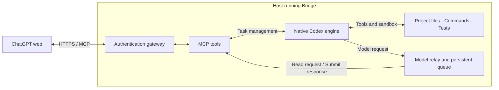

# ChatGPT MCP Bridge

[中文](README.md) · **v2 / 2.0.0** · [Version policy](docs/versioning.md)

Use the native Codex development engine through MCP from ChatGPT web to inspect code, edit files, run commands and execute tests in a configured workspace.

## Out of Codex usage? Continue some development work with ChatGPT web + MCP

If your Codex usage is temporarily exhausted and ChatGPT still provides the required model and MCP tools, this project offers another way to continue routine development:

- Read and edit code: explore project structure, understand implementations and make changes.
- Run commands and tests: execute scripts, investigate failures and verify fixes.
- Manage development tasks: inspect logs, processes, Git state and experiments.
- Continue longer tasks: use native planning, tool loops, history compaction, goals and task recovery.

ChatGPT produces model responses and tool calls. The native Codex engine manages tasks, executes tools and maintains development history. Bridge transports requests and responses through MCP. The engine is built from the Codex App Server/core source included in the repository.

Deploy Bridge on the host containing the projects you want to operate. Linux server deployment has been tested; native macOS/Windows deployment has not.

This project does not add or restore Codex usage. Available capabilities depend on ChatGPT permissions, usage limits and deployment settings; full Codex product functionality and equivalent performance are not guaranteed.

## Runtime diagram



The main path runs left to right. The model relay listens on loopback and routes native model requests to ChatGPT through MCP.

1. ChatGPT calls start_agent and retains the thread_id.
2. Codex generates a model request.
3. ChatGPT calls next_model_request; read_model_request pages large contexts.
4. ChatGPT returns text or offered native tool calls with submit_model_response.
5. Codex executes calls, records results and continues.
6. ChatGPT services requests and checks get_agent_status until completion, pause or required user input.

Return native tool calls to Codex rather than executing another copy with host tools.

## Usage

Connect an already deployed MCP service, complete authentication and enable it in the conversation. Confirm that start_agent and next_model_request appear in tool discovery.

Example prompt:

> Use ChatGPT MCP Bridge in /path/to/project. Investigate the failing tests, make a plan, implement the fix and run relevant tests. Continue servicing native Codex model requests until complete or user input is required.

For durable goals, explicitly request /goal. To recover work in another conversation, use list_agent_tasks and resume the saved thread_id.

### Linux installation

Prerequisites: Python 3.11+, Rust 1.99.1, a C compiler, pkg-config, libcap headers and OpenSSL headers.


The sandbox also requires permission to create unprivileged user and network namespaces. Ubuntu hosts with AppArmor may need an appropriate profile for the bundled Bubblewrap executable; see the [Ubuntu namespace notes](https://discourse.ubuntu.com/t/ubuntu-24-04-lts-noble-numbat-release-notes/39890). Check this prerequisite with `unshare --user --map-root-user --net /bin/true`.
```bash
python3 -m venv .venv
export MCP_BRIDGE_ENV_PREFIX="$PWD/.venv"
export MCP_BRIDGE_WORKSPACE=/absolute/path/to/projects
bash deploy/install.sh
bash deploy/run-http.sh
```

The installer builds native components, installs Python dependencies and creates private local tokens. HTTP defaults to 127.0.0.1:8000. In another terminal:

```bash
.venv/bin/python deploy/doctor-mcp.py --probe-execute --probe-agent
```

The model probe uses a preset response to verify transport, not autonomous webpage continuation. Existing Conda users can use the chatgpt-mcp-bridge environment and set MCP_BRIDGE_ENV_PREFIX to its prefix.

### Connect ChatGPT web

Provide an authenticated HTTPS MCP endpoint. The gateway module handles OAuth/proxying; deploy/start-gateway.sh reads private GitHub OAuth settings, allowed account IDs and the public base URL. The cloudflared directory supports the existing tunnel deployment.

Add https://your-domain.example/mcp using the custom MCP/developer connection available to your account, complete authentication and enable it in the conversation. Follow the [official connection documentation](https://developers.openai.com/plugins/deploy/connect-chatgpt) for current host settings.

For hosts supporting plugin packages:

```bash
python scripts/build_plugin.py \
  --web-url https://your-domain.example/mcp \
  --output dist/chatgpt-mcp-bridge-web.zip
```

The ZIP includes declarations and workflow instructions, not the server or credentials. It does not deploy anything. Omitting --web-url generates a desktop stdio configuration.

### Task commands

agent_command accepts /goal <objective>, /goal, /goal pause|resume|clear, /compact, /status, /pause, /resume [message] and /fork. Pass the saved thread_id. These are tool arguments, not automatically registered ChatGPT slash commands. Service requests produced by compaction and goal continuation.

## Modules and tools

| Path | Responsibility |
| --- | --- |
| src/chatgpt_mcp_bridge/agent/ | Native processes, tasks, goals and recovery |
| src/chatgpt_mcp_bridge/model_bridge/ | Durable queue, Responses/SSE, paging and deltas |
| src/chatgpt_mcp_bridge/runtime/ | Direct execution and lifecycle |
| src/chatgpt_mcp_bridge/tools/ | MCP operations |
| src/chatgpt_mcp_bridge/transport/ | MCP transport and access validation |
| src/chatgpt_mcp_bridge/gateway/ | OAuth and proxy |
| src/chatgpt_mcp_bridge/security/ | Redaction |
| runtime/, vendor/ | Rust entry points and pinned upstream sources |
| plugin/, deploy/, tests/, docs/ | Workflow package, deployment, verification and documentation |

Task tools: start_agent, list_agent_tasks, get_agent_status, next_model_request, read_model_request, submit_model_response, agent_command, answer_agent_request.

Direct tools: get_environment, execute, exec_command, remote_ssh, write_stdin, terminate_process, read_file, write_file, apply_patch. `remote_ssh` opens a persistent SSH shell using the Bridge host's SSH configuration and trusted host keys; use `write_stdin` to send commands and `terminate_process` to disconnect. Network access and noninteractive authentication are required. Remote commands run with the remote account's permissions.

## Configuration and limits

MCP_BRIDGE_WORKSPACE selects the workspace; MCP_BRIDGE_ENV_PREFIX selects Python; MCP_BRIDGE_STATE_DIR defaults to ~/.local/state/chatgpt-mcp-bridge; MCP_BRIDGE_NETWORK_ACCESS defaults to false in sandboxed mode. MCP_BRIDGE_HTTP_PORT defaults to 8000. MCP_BRIDGE_HTTP_TOKEN_FILE selects the private HTTP token. Previous variable names and private configuration paths remain compatible. This deployment is single-user; authorized clients share the OS account.

The `deploy/run-http.sh` and `deploy/run-stdio.sh` launch scripts default to `MCP_BRIDGE_FULL_ACCESS=true`. This disables the OS sandbox and enables network access, so commands run with the operating system account's permissions. The workspace still limits working directory selection but is not a filesystem boundary. Set `MCP_BRIDGE_FULL_ACCESS=false` before launching to use the sandbox. Invoking `chatgpt-mcp-bridge` directly defaults to sandboxed mode when the variable is unset.

- Codex requires ChatGPT to keep servicing requests. MCP cannot wake a closed or completed webpage conversation or guarantee unattended infinite execution.
- Native history persists independently from webpage history. /compact only compacts native task history.
- Token accounting is estimated from payload sizes, not actual webpage usage or billing.
- The server passed 176 tests and native request round-trip checks through MCP and the gateway. GitHub Actions is a separate environment; consult the result for the relevant commit.
- Native macOS/Windows deployment and same-model performance parity have not been validated.

See [architecture](docs/architecture.md) and [third-party notices](THIRD_PARTY_NOTICES.md).
