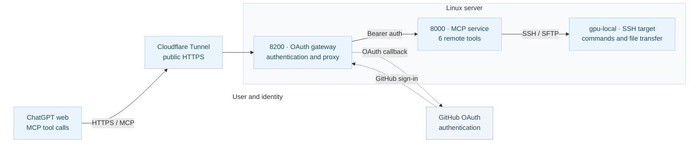

# ChatGPT MCP Bridge

[简体中文](README.md) | **English**

### Codex quota exhausted? Continue development tasks with ChatGPT + MCP

When Codex usage is temporarily exhausted, **ChatGPT on the web + MCP** can still help with selected development workflows: inspecting and editing code, running commands and tests, reading logs, managing Git, and checking experiments on servers **you are authorized to access**.

Describe the task in ChatGPT instead of repeatedly switching between a terminal and a chat window. ChatGPT handles the conversation and tool calls; the MCP service supplies remote SSH/SFTP capabilities.

**This does not increase, restore, or bypass Codex quota, and cannot fully replace Codex.** Tool availability depends on your ChatGPT access and limits, connector permissions, network, and server configuration.

This project combines an SSH MCP server, GitHub OAuth gateway, Cloudflare HTTPS Tunnel, connector manifests, and tests. The SSH MCP implementation builds on [blackaxgit/ssh-mcp](https://github.com/blackaxgit/ssh-mcp).

## Use the plugin in ChatGPT

1. Open **Settings → Plugins** in ChatGPT and enable the **ChatGPT MCP Bridge** connector.
2. For a new custom MCP connector, enter `https://<your-public-https-domain>/mcp`, choose OAuth, and authenticate with GitHub.
3. In chat, select **@ChatGPT MCP Bridge** and ask, for example:
   - “List the available SSH servers.”
   - “Run `hostname`, `whoami`, and `uptime` on `gpu-local`.”
   - “Inspect Git status and processes in `/home/test/Double` without changing anything.”
   - “Edit the specified file, run tests, then commit.”

| Tool | Description |
| --- | --- |
| `list_servers` | Discover configured remote servers |
| `list_groups` | Discover server groups |
| `execute` | Run a command on one server |
| `execute_on_group` | Execute commands across a group |
| `upload_file` | Upload via SFTP |
| `download_file` | Download via SFTP |

Only grant access to trusted systems. Review destructive operations, broad edits, restarts, and force pushes before execution.

## Architecture

Solid arrows show MCP requests; dashed arrows show GitHub OAuth.



**ChatGPT → Cloudflare → 8200 OAuth gateway → 8000 MCP server → SSH/SFTP.**

| Component | Role |
| --- | --- |
| ChatGPT + MCP | Understand requests and call remote tools |
| Cloudflare Tunnel | Public HTTPS endpoint forwarded to local port 8200 |
| GitHub OAuth | Authenticate approved users; does not execute SSH |
| **8200 OAuth gateway** | Issue/verify access tokens and forward `/mcp` requests |
| **8000 MCP backend** | Implement the six MCP remote tools |
| `gpu-local` | Example authorized SSH target |

**Ports 8000 and 8200 are not competing versions.** Port 8000 is the live upstream backend; stopping it breaks tool calls even when OAuth on 8200 succeeds. Port **8202** is only an optional test gateway and does not need to be running. Both 8000 and 8200 should bind to `127.0.0.1`, not a publicly accessible interface.

## Repository structure

- `src/ssh_mcp/` — SSH/SFTP/MCP source code
- `gateway/app.py` — GitHub OAuth, ChatGPT authorization, and MCP reverse proxy
- `cloudflared/cloudflared` — bundled Linux x86_64 Cloudflared v2026.10.1
- `cloudflared/run-oauth-tunnel.sh` — Tunnel launcher targeting port 8200
- `deploy/` — environment setup, launchers, health diagnostics, service template
- `config/` — example server inventory
- `plugin/` — connector manifests and `skills/remote-ssh/SKILL.md`
- `scripts/build_plugin.py` — build a plugin ZIP
- `tests/`, `integration/tests/` — unit and integration tests
- `pyproject.toml`, `uv.lock`, `LICENSE` — packaging and licensing

Do **not** commit `~/.config/ssh-mcp/servers.toml`, SSH keys, Bearer tokens, GitHub OAuth secrets, or runtime logs.

## Complete setup (five steps)

Perform these steps on the Linux server running MCP, not the computer from which you open ChatGPT. If services already exist, inspect their ports and configuration instead of starting duplicates.

### 1. Clone the repository and configure Conda

```bash
mkdir -p /home/test/Double
cd /home/test/Double
git clone https://github.com/Double-wk/ChatGPT-MCP-Bridge.git
cd ChatGPT-MCP-Bridge

# New deployments only — do not overwrite a live deployment.
export SSH_MCP_PROJECT_DIR="$PWD"
bash deploy/setup-conda.sh
export SSH_MCP_CONDA_PREFIX="$(conda run -n chatgpt-ssh-mcp python -c 'import sys; print(sys.prefix)' | tail -n 1)"
"$SSH_MCP_CONDA_PREFIX/bin/python" -m pip install uvicorn httpx starlette python-multipart
```

`deploy/setup-conda.sh` creates/reuses the Conda environment and only creates missing `servers.toml` / `http-token` files under `~/.config/ssh-mcp/`. Edit your server inventory and `~/.ssh/config`, then check the SSH connection:

```bash
ssh -o BatchMode=yes gpu-local hostname
```

The existing Conda environment is named `chatgpt-ssh-mcp`; the repository is `ChatGPT-MCP-Bridge`. Their names need not match.

Create the gateway token only if it is absent:

```bash
install -d -m 700 "$HOME/.config/ssh-mcp"
if [ ! -f "$HOME/.config/ssh-mcp/gateway-token" ]; then
  umask 077
  "$SSH_MCP_CONDA_PREFIX/bin/python" -c 'import secrets; print(secrets.token_urlsafe(48))' > "$HOME/.config/ssh-mcp/gateway-token"
fi
chmod 600 "$HOME/.config/ssh-mcp/http-token" "$HOME/.config/ssh-mcp/gateway-token"
```

Never regenerate production tokens as part of a documentation or code update.

### 2. Create a GitHub OAuth App

In [GitHub Developer Settings → OAuth Apps](https://github.com/settings/developers), create:

```text
Application name:
ChatGPT MCP Bridge

Homepage URL:
https://<current-tunnel-domain>/

Authorization callback URL:
https://<current-tunnel-domain>/oauth/github/callback
```

**The GitHub and ChatGPT callbacks are different.** GitHub redirects to your gateway (`/oauth/github/callback`). The URL generated by ChatGPT (`https://chatgpt.com/connector/oauth/<callback_id>`) belongs to the ChatGPT connection, **not** the GitHub OAuth App.

When the Quick Tunnel domain changes, update the GitHub App callback and all related connector addresses.

### 3. Configure credentials in a private environment file

```bash
install -d -m 700 "$HOME/.config/ssh-mcp"
vi "$HOME/.config/ssh-mcp/github-oauth.env"
chmod 600 "$HOME/.config/ssh-mcp/github-oauth.env"
```

Fill it with your private values (placeholders shown here):

```dotenv
GITHUB_CLIENT_ID=your_GitHub_client_ID
GITHUB_CLIENT_SECRET=your_GitHub_client_secret
GITHUB_ALLOWED_IDS=approved_GitHub_numeric_user_ID
GATEWAY_PUBLIC_BASE=https://current-tunnel-domain
```

`GITHUB_ALLOWED_IDS` must explicitly list allowed user IDs. Do not place real secrets in the repository. Load the environment and set the ChatGPT client ID:

```bash
set -a
. "$HOME/.config/ssh-mcp/github-oauth.env"
set +a
export CHATGPT_OAUTH_CLIENT_ID=chatgpt-mcp-bridge
```

You do not need to hardcode `CHATGPT_OAUTH_REDIRECT_URI` for a particular ChatGPT connector: the gateway recognizes supported connector-specific redirects.

### 4. Start the MCP service, Tunnel, and OAuth gateway

The examples below are for **new deployments**. Check whether ports 8000/8200 and Tunnel processes are already running.

Start the internal MCP backend on port **8000**:

```bash
cd /home/test/Double/ChatGPT-MCP-Bridge
export SSH_MCP_PROJECT_DIR="$PWD"
bash deploy/start-nohup.sh
```

Start a Cloudflare Quick Tunnel and read its HTTPS hostname:

```bash
nohup ./cloudflared/run-oauth-tunnel.sh > gateway/tunnel-8200.log 2>&1 < /dev/null &
tail -n 30 gateway/tunnel-8200.log
```

Set the returned hostname in `GATEWAY_PUBLIC_BASE` and the GitHub OAuth App. Then start the **8200** gateway:

```bash
set -a
. "$HOME/.config/ssh-mcp/github-oauth.env"
set +a
export SSH_MCP_PROJECT_DIR=/home/test/Double/ChatGPT-MCP-Bridge
nohup bash deploy/start-gateway.sh > gateway/gateway.log 2>&1 < /dev/null &
```

Do not start duplicates. Restarting a Quick Tunnel may change its public URL, breaking the ChatGPT and GitHub callbacks unless you update them. A fixed hostname is recommended for long-running deployments.

The checked-in `deploy/chatgpt-ssh-mcp.service` is a **systemd template for port 8000 only**; it does not configure the gateway or Tunnel, and changing the file does not update an already-installed service unit.

### 5. Configure ChatGPT MCP Bridge

Create a custom MCP connector in ChatGPT:

```text
MCP Server URL:
https://<current-tunnel-domain>/mcp
```

Choose **OAuth** and, if prompted, enter:

| Setting | Value |
| --- | --- |
| Registration method | Custom OAuth client |
| OAuth client ID | `chatgpt-mcp-bridge` |
| OAuth client secret | Leave empty |
| Token endpoint authentication | `none` |
| Authorization URL | `https://<current-tunnel-domain>/oauth/authorize` |
| Token URL | `https://<current-tunnel-domain>/oauth/token` |
| Registration URL | Leave empty |
| Authorization server base URL | `https://<current-tunnel-domain>` |
| Resource | `https://<current-tunnel-domain>/mcp` |
| Default/base scopes | Leave empty |
| OIDC | Disabled |

Keep the automatically generated ChatGPT callback URL. Authenticate with GitHub, then test `list_servers` or a read-only `hostname` command.

## Maintenance and troubleshooting

**Verified on 2026-10-21:** The connected deployment had working Cloudflare → 8200 → 8000 → SSH tool calls. The already-running 8000 process still reported the old, now-deleted working directory `/home/test/Double/chatgpt-web-mcp`. That does **not** make the process redundant: it still serves the MCP backend.

The checked-in `deploy/chatgpt-ssh-mcp.service` template and `deploy/start-nohup.sh` now refer to `/home/test/Double/ChatGPT-MCP-Bridge`. Updating Git does **not** update an installed systemd unit or restart an existing process. Before a planned migration, preserve private credentials, verify the original launch configuration, and test the replacement safely.

**Read-only health checks:**

```bash
cd /home/test/Double/ChatGPT-MCP-Bridge
ss -lntp | grep -E ':(8000|8200|29966)\b'
curl -sS -o /dev/null -w '%{http_code}\n' http://127.0.0.1:8200/healthz
curl -sS -o /dev/null -w '%{http_code}\n' http://127.0.0.1:8200/.well-known/oauth-authorization-server
curl -sS -o /dev/null -w '%{http_code}\n' http://127.0.0.1:8200/mcp

PY=/mnt/tcm_agent_data/Double/envs/chatgpt-ssh-mcp/bin/python
"$PY" deploy/doctor-mcp.py --probe-execute
"$PY" -m unittest discover -s integration/tests -p 'test*.py' -v
```

Expected: `/healthz` and OAuth metadata return **200**; an *unauthenticated* `/mcp` request normally returns **401**. The doctor tool discovers six tools and runs a fixed read-only `hostname` on the example server `gpu-local` when using `--probe-execute`.

**HTTP 503 or connection buildup:** Previous SSE forwarding logic could leave connections open. The current gateway streams upstream responses and releases resources on cancellation; still validate it with tests and live connection counts. An unused **8202** port can host a separate test gateway, but the production gateway remains at 8200 → 8000.

**Build a plugin ZIP:**

```bash
"$PY" scripts/build_plugin.py --web-url "https://<your-domain>/mcp" \
  --output /tmp/chatgpt-mcp-bridge.zip
```

Never publish SSH private keys, credentials, OAuth authorization codes/state parameters, tokens, or logs.

## Licensing and acknowledgments

This project integrates existing open-source components and does not claim to be written entirely from scratch:

- [blackaxgit/ssh-mcp](https://github.com/blackaxgit/ssh-mcp): source for the SSH/SFTP/MCP backend. The applicable license is **Mozilla Public License 2.0 (MPL-2.0)**; see [LICENSE](LICENSE). Integration changes do not imply upstream endorsement.
- [Cloudflare/cloudflared](https://github.com/cloudflare/cloudflared): HTTPS Tunnel client, under **Apache License 2.0**, see [upstream license](https://github.com/cloudflare/cloudflared/blob/master/LICENSE) and bundled [cloudflared/LICENSE](cloudflared/LICENSE).
- [Model Context Protocol](https://modelcontextprotocol.io/): MCP specification and tool protocol.

## OAuth refresh and durable credentials

The updated gateway supports `authorization_code` and `refresh_token`; discovery advertises `offline_access` and `mcp`. An authorization issues a **one-hour access token** and a **rotating refresh token**, with a maximum refresh-token lifetime of **30 days from the initial login**. Rotation does not extend the absolute login lifetime.

Tokens are stored only as **SHA-256 digests** in a private SQLite database. Refresh rotation is atomic; consumed refresh tokens cannot be replayed. The default private path is `~/.config/ssh-mcp/oauth-tokens.sqlite3` (file mode `600`; private parent directory). Override only with a secure private path using `GATEWAY_TOKEN_DB`. The startup script is `deploy/start-gateway.sh`, and `GATEWAY_PUBLIC_BASE` must be saved in its private environment file.

**One-time migration:** Existing tokens from the old gateway exist only in that process's memory. On the first restart into the upgraded gateway, ChatGPT may need to authorize **once more** to obtain a refresh token. If ChatGPT cached the old OAuth discovery document, re-scan or recreate the connector to fetch the new metadata. Tokens issued by the new gateway survive subsequent restarts.

**Stable Tunnel:** For production, replace the temporary `trycloudflare.com` Quick Tunnel with a named Cloudflare Tunnel and fixed DNS hostname. That requires your own Cloudflare account and managed DNS domain, and it cannot be completed using only the public repository. Keep the current Tunnel running until the named Tunnel works; then update `GATEWAY_PUBLIC_BASE`, the GitHub OAuth callback, and the ChatGPT MCP URL together.

## Git history and deployment policy

The published `main` branch deliberately has **one root commit** containing the latest snapshot. Updating it this way rewrites history: existing clones may need to be re-cloned or explicitly reconciled. Older objects may still exist in caches or other clones.

**Updating GitHub does not restart or redeploy the running MCP services.**
