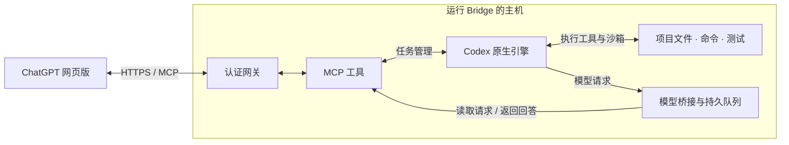

# ChatGPT MCP Bridge

[English](README.en.md) · **v2 / 2.0.0** · [版本约定](docs/versioning.md)

让 ChatGPT 网页版通过 MCP 调用 Codex 原生开发引擎，在指定工作目录中阅读代码、修改实现、运行命令和执行测试。

## Codex 额度不够用了？通过 ChatGPT 网页版 + MCP 继续部分开发工作

当 Codex 额度暂时用尽，而 ChatGPT 仍可使用所需的模型与 MCP 工具时，可以尝试通过本项目继续推进开发任务：

- **阅读与修改代码**：了解项目结构、分析实现、调整代码。
- **运行命令与测试**：执行脚本、定位错误、验证修改结果。
- **管理开发任务**：查看日志和进程、检查 Git 状态、跟踪实验进展。
- **持续推进工作**：使用原生任务规划、工具循环、历史压缩、目标管理和任务恢复。

ChatGPT 负责理解需求并生成回答或工具调用，Codex 原生引擎负责组织任务、执行工具和维护开发历史，Bridge 通过 MCP 在两者之间传递请求与结果。原生引擎由仓库内的 Codex App Server 和 core 源码编译。

将 Bridge 部署在需要操作的主机上，即可通过 MCP 访问该主机上的项目。目前已验证 Linux 服务器部署；macOS / Windows 原生部署尚未验证。

本项目不会增加或恢复 Codex 额度。实际可用能力受 ChatGPT 账号权限、使用限制和部署环境影响，也不等同于 Codex 产品的完整功能与性能。

## 运行结构图



主流程从左到右：网页端连接 MCP，Codex 在目标主机上执行开发任务。模型桥接监听本机回环地址，将 Codex 的模型请求交给网页端回答。

### 一次任务如何推进

1. 网页端调用 `start_agent` 创建任务，保存返回的 `thread_id`。
2. Codex 根据任务历史生成模型请求。
3. 网页端调用 `next_model_request` 读取请求；较长的上下文通过 `read_model_request` 分页读取。
4. 网页端调用 `submit_model_response` 返回回答或原生工具调用。
5. Codex 执行工具、收集输出、更新任务历史，并生成下一轮请求。
6. 网页端继续处理请求，并通过 `get_agent_status` 检查状态，直到任务完成、暂停或需要用户输入。

原生工具调用应返回给 Codex 执行，避免网页端额外执行一遍相同操作。

## 如何使用

### 连接已有服务

1. 在 ChatGPT 中添加已部署的 MCP 连接，完成认证。
2. 在对话中启用该连接，确认可以发现 `start_agent`、`next_model_request` 等工具。
3. 描述任务和工作目录；后续在同一个任务中持续处理模型请求。

可以直接这样说：

> 使用 ChatGPT MCP Bridge，在 /path/to/project 中检查测试失败原因，先制定计划，再修改代码并运行相关测试。持续处理 Codex 发出的模型请求，直到完成或确实需要我提供信息。

需要持久目标时，可以说：

> 为这个任务创建 /goal，完成修复并验证；如果当前会话中断，下次继续同一个任务。

### 新部署：Linux

先准备 Python 3.11+、Rust 1.99.1、C 编译器、pkg-config、libcap 开发文件和 OpenSSL 开发文件。以下命令从仓库根目录执行：


运行沙箱还需要系统允许创建非特权用户与网络命名空间。启用 AppArmor 的 Ubuntu 环境可能需要为打包的 Bubblewrap 配置相应策略，参见 [Ubuntu 的命名空间说明](https://discourse.ubuntu.com/t/ubuntu-24-04-lts-noble-numbat-release-notes/39890)。可以先运行 `unshare --user --map-root-user --net /bin/true` 检查这项前置条件。
```bash
python3 -m venv .venv
export MCP_BRIDGE_ENV_PREFIX="$PWD/.venv"
export MCP_BRIDGE_WORKSPACE=/absolute/path/to/projects
bash deploy/install.sh
bash deploy/run-http.sh
```

安装脚本编译仓库内的原生组件、安装 Python 包，并生成本机私有令牌。HTTP 服务默认监听 `127.0.0.1:8000`。

在另一个终端验证：

```bash
.venv/bin/python deploy/doctor-mcp.py --probe-execute --probe-agent
```

诊断脚本会验证认证、16 个工具、执行功能和一次原生模型请求回传。模型回传探针使用预设测试回答，不代表 GPT 网页端自动持续运行已经得到保证。

如使用现有 Conda 环境，激活 `chatgpt-mcp-bridge`，并把 `MCP_BRIDGE_ENV_PREFIX` 指向该环境路径即可；不要重复创建环境。

### 接入 ChatGPT 网页端

将 MCP 服务通过带认证的 HTTPS 入口提供给 ChatGPT。仓库内 `gateway/` 模块负责 OAuth 与代理，`deploy/start-gateway.sh` 读取私有 OAuth 配置；`cloudflared/` 提供现有部署使用的隧道启动脚本。

网关部署需要 GitHub OAuth 应用、允许访问的账号 ID 和公开 HTTPS 基址。具体环境变量及读取位置见 [网关启动脚本](deploy/start-gateway.sh)。凭据保存在服务器私有配置中。

在账号支持的自定义 MCP / 开发者连接入口中添加 `https://your-domain.example/mcp`，完成认证，然后在对话中启用它。使用设置和可用入口以 [OpenAI 官方连接说明](https://developers.openai.com/plugins/deploy/connect-chatgpt) 为准。

若客户端支持插件包，可生成引用已部署 HTTPS 服务的 ZIP：

```bash
python scripts/build_plugin.py \
  --web-url https://your-domain.example/mcp \
  --output dist/chatgpt-mcp-bridge-web.zip
```

ZIP 提供插件声明和任务工作流程说明，不包含服务器程序或认证凭据，也不会自动部署服务。网页端优先使用支持的自定义 MCP 连接入口。省略 `--web-url` 生成的是桌面 stdio 配置。

### 任务命令

在对话中表达需求，让 ChatGPT 调用 `agent_command` 并传入已有任务的 `thread_id`：

| 命令 | 行为 |
| --- | --- |
| `/goal <目标>` | 设置原生持久目标 |
| `/goal` | 查看目标 |
| `/goal pause`、`/goal resume`、`/goal clear` | 暂停、恢复或清除目标 |
| `/compact` | 压缩 Codex 任务历史，需要继续回答压缩请求 |
| `/status` | 查看任务状态 |
| `/pause` | 中断当前轮次并暂停目标 |
| `/resume [补充消息]` | 恢复任务 |
| `/fork` | 从当前任务历史创建分支任务 |

这些是 MCP 工具参数中的命令，不会自动注册为 ChatGPT 输入框的斜杠命令。新对话恢复任务时，先调用 `list_agent_tasks` 查找任务，再使用同一个 `thread_id` 恢复。

## 工具与模块

| 工具组 | MCP 工具 |
| --- | --- |
| 任务流程 | start_agent、list_agent_tasks、get_agent_status、next_model_request、read_model_request、submit_model_response、agent_command、answer_agent_request |
| 执行和文件 | get_environment、execute、exec_command、write_stdin、terminate_process、read_file、write_file、apply_patch |

开发任务优先通过任务流程工具推进；执行和文件工具适合明确的单步操作与诊断。

| 路径 | 职责 |
| --- | --- |
| `src/chatgpt_mcp_bridge/agent/` | 原生进程、任务、目标与恢复 |
| `src/chatgpt_mcp_bridge/model_bridge/` | 请求队列、Responses/SSE、分页和增量传输 |
| `src/chatgpt_mcp_bridge/runtime/` | 直接执行与共享生命周期 |
| `src/chatgpt_mcp_bridge/tools/` | MCP 工具定义 |
| `src/chatgpt_mcp_bridge/transport/` | MCP 传输与认证校验 |
| `src/chatgpt_mcp_bridge/gateway/` | OAuth 与代理 |
| `src/chatgpt_mcp_bridge/security/` | 敏感信息处理 |
| `runtime/`、`vendor/` | Rust 入口、固定版本的原生源码与依赖 |
| `plugin/` | 插件声明与网页端工作流程 |
| `deploy/`、`tests/`、`docs/` | 构建部署、验证与文档 |
| `.build/`、`.build-tools/` | 本机构建缓存、工具链和内部备份 |
| `logs/`、`dist/` | 日志与分发产物 |

## 配置

| 配置项 | 用途 |
| --- | --- |
| `MCP_BRIDGE_WORKSPACE` | 允许操作的项目根目录 |
| `MCP_BRIDGE_ENV_PREFIX` | Python 环境路径 |
| `MCP_BRIDGE_STATE_DIR` | 持久状态目录，默认 `~/.local/state/chatgpt-mcp-bridge` |
| `MCP_BRIDGE_NETWORK_ACCESS` | 执行环境网络权限，默认关闭 |
| `MCP_BRIDGE_HTTP_PORT` | MCP HTTP 监听端口，默认 8000 |
| `MCP_BRIDGE_HTTP_TOKEN_FILE` | MCP HTTP 私有令牌文件 |

部署脚本仍兼容旧变量名；应用层优先读取新的 `MCP_BRIDGE_*` 配置。当前部署面向单用户，获准访问的客户端共享服务器系统账号。

## 能力边界与验证

- 网页端需要继续读取并回答模型请求，Codex 才能推进。MCP 无法主动唤醒已结束或关闭的网页会话，不能保证无人值守无限循环。
- 原生任务历史与桥接记录保存在服务器；它们与 ChatGPT 网页会话历史分开。任务恢复仍需要一个能继续调用工具的会话。
- `/compact` 压缩 Codex 任务历史，不会压缩网页会话。
- 桥接层按请求大小估算 token 用量，用于原生计量和压缩触发，不代表网页端实际用量或计费。
- 原生规划、执行、文件修改、测试、压缩、目标续跑、暂停恢复和沙箱限制已通过服务器测试。部署时通过 176 项测试，并验证 MCP 和网关的原生请求回传。
- 服务器测试与 GitHub Actions 是不同的验证环境；仓库自动检查状态以对应提交的 Actions 结果为准。
- 尚未验证 macOS / Windows 原生部署，也未进行与独立 Codex 同模型条件下的性能对比。

进一步阅读：[架构说明](docs/architecture.md) · [第三方声明](THIRD_PARTY_NOTICES.md)。
