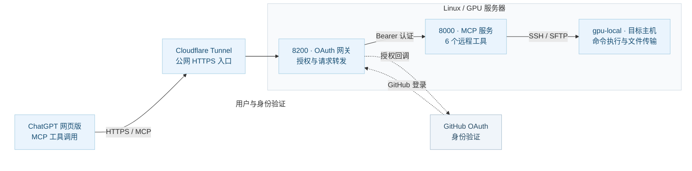

# ChatGPT MCP Bridge

**简体中文** | [English](README.en.md)

### Codex 额度不够用了？通过 ChatGPT 网页版 + MCP 继续部分开发工作

**当 Codex 额度暂时用尽，你仍然可以在 ChatGPT 网页版里完成一部分常见开发操作。**

如果你平时使用 Codex 查看项目、修改代码、运行命令、执行测试或管理远程服务器，可以尝试用 **ChatGPT 网页版 + MCP** 完成其中的一部分：

- **查看与修改代码**：读取文件、理解项目、调整实现
- **运行命令与测试**：执行脚本、排查问题、检查测试结果
- **管理开发任务**：查看日志与进程、检查 Git 状态、追踪实验
- **操作授权服务器**：直接在聊天中执行常见远程操作

ChatGPT 负责理解需求与调用工具，MCP 负责将工具能力接入对话。本项目当前通过 **SSH / SFTP** 连接已授权的 Linux 主机；这些是底层实现，不需要用户在 ChatGPT 对话中手动输入 SSH 命令。

**这是 Codex 之外的一种工作方式，不会增加或恢复 Codex 额度，也无法完整替代 Codex 的全部能力。** 可用功能受当前 ChatGPT 工具权限、使用限制以及服务器配置影响。


---

这是一个面向 ChatGPT 网页版的 **远程开发 MCP 接入项目**：包含 MCP 远程工具、GitHub OAuth 网关、Cloudflare HTTPS Tunnel、插件配置及必要测试。SSH / SFTP 仅用于底层远程执行与文件传输。核心实现基于 [blackaxgit/ssh-mcp](https://github.com/blackaxgit/ssh-mcp)，许可证见 [LICENSE](LICENSE)。GitHub 更新不会自动部署到正在运行的服务器。

## 在 ChatGPT 中使用

1. 在 ChatGPT 的 **设置 → Plugins** 中连接或启用本项目的 MCP 连接器（现有连接器显示名为 **ChatGPT MCP Bridge**）。
2. 如需重新建立自定义 MCP 连接，地址为 `https://<你的 HTTPS 公网域名>/mcp`，选择 OAuth 并通过 GitHub 登录。
3. 在会话中选择现有连接器 **@ChatGPT MCP Bridge**，直接提出请求，例如：
   - “列出可用 SSH 服务器。”
   - “在 `gpu-local` 执行 `hostname`、`whoami` 和 `uptime`。”
   - “只读检查 `/home/test/Double` 下项目的 Git 状态和运行进程。”
   - “修改指定文件，运行测试通过后再提交。”

已接入的工具：`list_servers`、`list_groups`、`execute`、`execute_on_group`、`upload_file`、`download_file`。请只连接有权管理的服务器，避免在未经确认的情况下执行有破坏性的操作。

## 运行架构

ChatGPT 网页版通过 HTTPS MCP 调用远程工具。**实线表示工具请求，虚线表示 GitHub OAuth 登录授权**；SSH / SFTP 是服务器侧的底层执行方式。



**各组件负责什么？**

| 组件 | 主要职责 |
| --- | --- |
| **ChatGPT 网页版 + MCP** | 理解指令、发起 MCP 工具调用、展示结果 |
| **Cloudflare Tunnel** | 提供公网 HTTPS 通道，将请求安全转发到本地 8200 端口 |
| **GitHub OAuth** | 确认允许登录的 GitHub 用户身份；不负责运行 SSH 命令 |
| **8200 OAuth 网关** | 处理授权码与 Token、校验访问权限，把 MCP 请求转给内部服务 |
| **8000 SSH MCP** | 提供 `execute`、文件传输、服务器列表等 6 个工具 |
| **gpu-local** | 通过 SSH 执行命令或使用 SFTP 传输文件的目标主机 |

调用顺序可以记作：**ChatGPT → Cloudflare → 8200 网关 → 8000 MCP → SSH 主机**。首次连接或令牌失效时，才需要额外进行 GitHub OAuth 授权。

**注意端口不是新旧版本的关系**：8000 是仍在使用的 MCP 核心服务，8200 仅负责 OAuth 认证和代理，二者都需要保留。8202 只是临时测试端口，当前无需启动。启动较早不代表 8000 已废弃；直接停止 8000 会使 MCP 工具不可用。

仓库主要内容：

- `src/ssh_mcp/`：SSH / SFTP / MCP 核心源码
- `gateway/app.py`：GitHub OAuth、ChatGPT 授权及 MCP 代理
- `cloudflared/cloudflared`：Cloudflared Linux x86_64 v2026.10.1 二进制
- `cloudflared/run-oauth-tunnel.sh`：把 HTTPS Tunnel 指向 8200 网关
- `deploy/`：启动、安装和诊断脚本；`config/`：服务器清单示例
- `plugin/`：插件清单、MCP 配置和 `skills/remote-ssh/SKILL.md`
- `scripts/build_plugin.py`：生成插件 ZIP
- `tests/`、`integration/tests/`：功能与打包回归测试
- `pyproject.toml`、`uv.lock`、`LICENSE`：构建与许可

实际配置和密钥**不提交 Git**：`~/.config/ssh-mcp/servers.toml`、SSH 私钥、Bearer Token、GitHub OAuth Secret、网关运行日志均位于私有运行环境。

## 完整配置流程（五步）

以下步骤把代码下载、GitHub 身份验证、服务器启动和 ChatGPT 连接串起来。代码可以先下载到本地查看，但 8000、8200 和 Cloudflare Tunnel 应运行在提供 MCP 的目标 Linux 服务器上；笔记本不需要启动这些端口。

### 1. 下载项目并准备 Conda 环境

```bash
mkdir -p /home/test/Double
cd /home/test/Double
git clone https://github.com/Double-wk/ChatGPT-MCP-Bridge.git
cd ChatGPT-MCP-Bridge

# 以下仅针对首次部署；已有实例不要覆盖正在运行的环境
export SSH_MCP_PROJECT_DIR="$PWD"
bash deploy/setup-conda.sh
export SSH_MCP_CONDA_PREFIX="$(conda run -n chatgpt-ssh-mcp python -c 'import sys; print(sys.prefix)' | tail -n 1)"
"$SSH_MCP_CONDA_PREFIX/bin/python" -m pip install uvicorn httpx starlette python-multipart
```

`deploy/setup-conda.sh` 会创建或复用运行环境，仅生成缺失的内部 Token 与服务器清单，不覆盖已有私有配置。编辑 `~/.config/ssh-mcp/servers.toml` 和 SSH 配置后，先确认 `ssh -o BatchMode=yes gpu-local hostname` 可用。仓库目录名是 `ChatGPT-MCP-Bridge`，现有 Conda 环境名继续使用 `chatgpt-ssh-mcp`，两者无须一致。

在首次部署时，还应创建网关专用 Token（已有则保留）：

```bash
install -d -m 700 "$HOME/.config/ssh-mcp"
if [ ! -f "$HOME/.config/ssh-mcp/gateway-token" ]; then
  umask 077
  "$SSH_MCP_CONDA_PREFIX/bin/python" -c 'import secrets; print(secrets.token_urlsafe(48))' > "$HOME/.config/ssh-mcp/gateway-token"
fi
chmod 600 "$HOME/.config/ssh-mcp/http-token" "$HOME/.config/ssh-mcp/gateway-token"
```

**已有部署不要直接重装、重复启动或覆盖运行中的配置。** 先确认服务工作目录、端口和密钥来源，再安排重启。

### 2. 创建 GitHub OAuth App

在 GitHub Developer Settings → OAuth Apps → New OAuth App 中填写：

```text
Application name:
ChatGPT MCP Bridge

Homepage URL:
https://<当前 Tunnel 域名>/

Authorization callback URL:
https://<当前 Tunnel 域名>/oauth/github/callback
```

GitHub 回调必须指向网关地址。ChatGPT 页面显示的 `https://chatgpt.com/connector/oauth/<callback_id>` 是另一层回调，不要填入 GitHub OAuth App。Quick Tunnel 地址变化后，Homepage URL 和 GitHub 回调都要同步更新。

### 3. 将 OAuth 参数注入服务器私有环境

不要把 Client Secret、Token 或私钥写进仓库。服务器上创建权限为 600 的私有环境文件：

```bash
install -d -m 700 "$HOME/.config/ssh-mcp"
vi "$HOME/.config/ssh-mcp/github-oauth.env"
```

文件内容使用实际值：

```dotenv
GITHUB_CLIENT_ID=你的_GitHub_Client_ID
GITHUB_CLIENT_SECRET=你的_GitHub_Client_Secret
GITHUB_ALLOWED_IDS=允许登录的_GitHub_数字用户ID
GATEWAY_PUBLIC_BASE=https://当前_Tunnel_域名
```

加载参数时使用：

```bash
set -a
. "$HOME/.config/ssh-mcp/github-oauth.env"
set +a
export CHATGPT_OAUTH_CLIENT_ID=chatgpt-mcp-bridge
```

`CHATGPT_OAUTH_REDIRECT_URI` 不需要固定填写；网关会接受 ChatGPT 当前连接生成的专属回调地址。

### 4. 在服务器后台启动服务

先确保内部 MCP 已配置好，再使用 `nohup` 启动。以下命令都在 GPU 服务器执行：

```bash
cd /home/test/Double/ChatGPT-MCP-Bridge

# 内部 MCP：127.0.0.1:8000
nohup bash deploy/run-http.sh > gateway/mcp-8000.log 2>&1 < /dev/null &

# Quick Tunnel：先启动并从日志读取生成的 https://*.trycloudflare.com 地址
nohup ./cloudflared/run-oauth-tunnel.sh > gateway/tunnel-8200.log 2>&1 < /dev/null &
tail -f gateway/tunnel-8200.log
```

读取 Tunnel 地址后，将它写入 `GATEWAY_PUBLIC_BASE` 和 GitHub OAuth App，再启动网关：

```bash
set -a
. "$HOME/.config/ssh-mcp/github-oauth.env"
set +a
export SSH_MCP_PROJECT_DIR=/home/test/Double/ChatGPT-MCP-Bridge
nohup bash deploy/start-gateway.sh > gateway/gateway.log 2>&1 < /dev/null &
```

如果 8000、8200 或 Tunnel 已经在运行，不要重复启动；先用 `ss -lnt` 和 `ps` 检查。Quick Tunnel 重启后地址可能变化，必须同步更新网关参数、GitHub 回调和 ChatGPT MCP URL。

### 5. 配置 ChatGPT MCP Bridge

在 ChatGPT 中添加自定义 MCP 服务器：

```text
MCP Server URL:
https://<当前 Tunnel 域名>/mcp
```

身份验证选择 OAuth，高级设置填写：

| 字段 | 值 |
| --- | --- |
| 注册方法 | 自定义 OAuth 客户端 |
| OAuth 客户端 ID | `chatgpt-mcp-bridge` |
| OAuth 客户端密钥 | 留空 |
| Token 端点身份验证 | `none` |
| 授权网址 | `https://<当前 Tunnel 域名>/oauth/authorize` |
| Token URL | `https://<当前 Tunnel 域名>/oauth/token` |
| 注册地址 | 留空 |
| 授权服务器基础地址 | `https://<当前 Tunnel 域名>` |
| 资源 | `https://<当前 Tunnel 域名>/mcp` |
| 默认/基础授权范围 | 留空 |
| OIDC | 关闭 |

回调 URL 使用 ChatGPT 页面自动生成的地址，不要手工改成 GitHub 回调。保存连接后完成 GitHub 登录，再在新对话中调用 `list_servers` 或执行 `hostname` 验证链路。

## 现有服务器状态与安全升级

**2026-10-21 实际核查：** ChatGPT → Cloudflare Tunnel → `127.0.0.1:8200` → `127.0.0.1:8000` → SSH 链路可用。当前 8000 进程的工作目录仍显示为已删除的 `/home/test/Double/chatgpt-web-mcp`；**这不代表该进程多余**，也不应该为整理目录直接将它停止。进程重启前应先把运行服务的启动路径迁移到 `/home/test/Double/ChatGPT-MCP-Bridge`。

本仓库已经将 `deploy/chatgpt-ssh-mcp.service` 和 `deploy/start-nohup.sh` 的旧目录替换为新项目目录。但 **Git 文件改变不会同步更新已经安装的 systemd 用户单元，也不会自动重启在线 MCP**。如要使用 systemd，先将模板按实际服务器的环境、权限和绝对路径调整，配置启动条件及持久化，再完成备份、切换与验证。模板只覆盖 8000，不管理 8200 或 Cloudflare Tunnel。

**只读健康检查（在服务器执行）：**

```bash
cd /home/test/Double/ChatGPT-MCP-Bridge
ss -lntp | grep -E ':(8000|8200|29966)\b'
curl -sS -o /dev/null -w '%{http_code}\n' http://127.0.0.1:8200/healthz
curl -sS -o /dev/null -w '%{http_code}\n' http://127.0.0.1:8200/.well-known/oauth-authorization-server
curl -sS -o /dev/null -w '%{http_code}\n' http://127.0.0.1:8200/mcp
PY=/mnt/tcm_agent_data/Double/envs/chatgpt-ssh-mcp/bin/python
"$PY" deploy/doctor-mcp.py --probe-execute
"$PY" -m unittest discover -s integration/tests -p 'test*.py' -v
```

期望 `/healthz` 与 OAuth metadata 返回 `200`；未认证的 `/mcp` 返回 `401` 属正常。诊断脚本默认检查 `gpu-local` 并执行只读的 `hostname`。已有 Token、服务器清单、OAuth Secret 和 Tunnel 的 HTTPS 地址不可在部署更新时擅自覆盖。

**异常和升级**：旧版网关可能出现 SSE 连接积压、`Exceeded concurrency limit` 或 HTTP 503。当前网关采用流式转发并在取消时关闭上游连接；仍应通过测试和实际指标验证。测试网关可临时使用未被占用的 8202，生产仍保持 8200 → 8000。未经测试不要直接重启 8000、8200 或 Tunnel。Quick Tunnel 重新启动可能更换域名，影响 GitHub OAuth 回调与 ChatGPT 连接地址。

**插件打包：**

```bash
"$PY" scripts/build_plugin.py --web-url "https://<你的域名>/mcp" --output /tmp/chatgpt-mcp-bridge.zip
```

## 开源致谢与许可证

本仓库并非从零实现所有组件。项目在开源软件基础上做了 **ChatGPT 接入、GitHub OAuth 网关与部署集成**，应保留原作者署名并明确修改范围：

- **[blackaxgit/ssh-mcp](https://github.com/blackaxgit/ssh-mcp)**：SSH MCP 核心实现、SSH/SFTP 工具、配置及相关测试的重要上游来源。感谢原项目贡献者。本仓库保留其源码，遵循 **Mozilla Public License 2.0（MPL-2.0）**，见根目录 [LICENSE](LICENSE)。本项目的 OAuth 网关、ChatGPT 插件配置与部署集成为额外工作，不代表原作者为这些修改背书。
- **[Cloudflare/cloudflared](https://github.com/cloudflare/cloudflared)**：提供 Cloudflare Tunnel 可执行程序，负责 HTTPS 访问通道。感谢 Cloudflare 维护开源项目。其开源许可证为 **Apache License 2.0**，参见 [Cloudflare 项目的许可证](https://github.com/cloudflare/cloudflared/blob/master/LICENSE) 和仓库随附的 `cloudflared/LICENSE`。仓库保留 Linux x86_64 版本的二进制文件，方便恢复部署。
- **[Model Context Protocol](https://modelcontextprotocol.io/)**：本项目遵循 MCP 协议与工具交互规范。

开源代码的许可证与本项目自定义部署配置不是同一回事：服务器私钥、GitHub OAuth Secret、Bearer Token 和访问日志不属于公开仓库内容，也不应提交到 Git。

## OAuth 自动续期及持久化

新版网关支持 OAuth `authorization_code` 和 `refresh_token`，元数据包含 `scopes_supported: ["mcp", "offline_access"]`。新的授权返回 **1 小时 Access Token + 可轮换的 Refresh Token**，刷新凭据最多有效 **30 天**（从最初授权算起；刷新不会无限延长会话）；超期需重新授权。

安全机制：随机令牌以 **SHA-256 摘要**形式写入服务器私有 SQLite 数据库，刷新时通过数据库事务轮换，旧 Refresh Token 立即失效；不会把令牌明文写入 Git。默认数据库位置 `~/.config/ssh-mcp/oauth-tokens.sqlite3`，权限应为 `600`，目录 `700`。可通过 `GATEWAY_TOKEN_DB` 指定其他私有绝对路径。网关启动脚本为 `deploy/start-gateway.sh`，启动前需设置并持久保存 `GATEWAY_PUBLIC_BASE`。需要备份时应加密并限制访问。

**升级说明**：老网关中的 Access Token 只保存在旧进程的内存，无法由新网关自动迁移。首次部署新网关后可能需要**重新连接一次** ChatGPT 插件，使其取得 Refresh Token；之后客户端可自动续期。若原插件缓存了旧 OAuth discovery，也可能需要重新扫描或创建连接。网关重启后，新数据库内的令牌保持有效。

长期运行还需要使用**固定域名的正式 Cloudflare Tunnel**：当前 Quick Tunnel 的 `trycloudflare.com` 临时地址可能在重启后变化，并且不适合依赖 SSE 的长期连接。正式 Tunnel 需要你自己的 Cloudflare 账户、可用的域名、对应的 DNS / Tunnel 配置，不能仅更改 README 或停止 Quick Tunnel 就完成迁移。配置完成后，同步修改 `GATEWAY_PUBLIC_BASE`、GitHub OAuth App 回调与 ChatGPT 插件的 MCP URL。**在正式 Tunnel 验证成功前保留现有 Quick Tunnel**。

## Git 历史管理

本仓库的 `main` 采用**单个根提交**展示当前可部署版本。后续若再次压缩历史，须使用有保护检查的强制推送；这会导致其他克隆中的 `main` 与远程历史分叉，应备份本地修改后重新克隆或明确重置。GitHub 上已不可达的旧提交可能仍存在于缓存或其他克隆中。**更新 GitHub 不会自动更新当前在线进程。**
