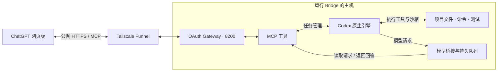

# ChatGPT MCP Bridge

[English](README.en.md) · **v3 / 3.0.0** · [版本约定](docs/versioning.md)

让 ChatGPT 网页版通过 MCP 调用 Codex 原生开发引擎，在指定工作目录中阅读代码、修改实现、运行命令和执行测试。

## Codex 额度不够用了？通过 ChatGPT 网页版 + MCP 继续部分开发工作

当 Codex 额度暂时用尽，而 ChatGPT 仍可使用所需的模型与 MCP 工具时，可以尝试通过本项目继续推进开发任务：

- **阅读与修改代码**：了解项目结构、分析实现、调整代码。
- **运行命令与测试**：执行脚本、定位错误、验证修改结果。
- **管理开发任务**：查看日志和进程、检查 Git 状态、跟踪实验进展。
- **持续推进工作**：使用原生任务规划、工具循环、历史压缩、目标管理和任务恢复。

ChatGPT 负责理解需求并生成回答或工具调用，Codex 原生引擎负责组织任务、执行工具和维护开发历史，Bridge 通过 MCP 在两者之间传递请求与结果。原生引擎由仓库内的 Codex App Server 和 core 源码编译。

将 Bridge 部署在需要操作的主机上，即可通过 MCP 访问该主机上的项目。当前优先说明 macOS Apple Silicon 部署，使用 Conda、Tailscale Funnel 和 GitHub OAuth。Linux 服务器部署也已验证；Windows 原生部署尚不支持。

本项目不会增加或恢复 Codex 额度。实际可用能力受 ChatGPT 账号权限、使用限制和部署环境影响，也不等同于 Codex 产品的完整功能与性能。

## 运行结构图



主流程从左到右：网页端连接 MCP，Codex 在目标主机上执行开发任务。模型桥接监听本机回环地址，将 Codex 的模型请求交给网页端回答。

### 一次任务如何推进

1. 网页端调用 `start_agent` 创建任务，保存返回的 `thread_id`。
2. Codex 根据任务历史生成模型请求。
3. 网页端调用 `next_model_request` 读取请求；较长的上下文通过 `read_model_request` 分页读取。
4. 网页端调用 `submit_model_response` 返回回答或原生工具调用。
5. Codex 执行工具、收集输出、更新任务历史，并生成下一轮请求。
6. 网页端继续处理请求，并通过 `get_agent_status` 检查状态，直到任务完成、暂停或需要用户输入。

原生工具调用应返回给 Codex 执行，避免网页端额外执行一遍相同操作。

## 如何使用

### 连接已有服务

1. 在 ChatGPT 中添加已部署的 MCP 连接，完成认证。
2. 在对话中启用该连接，确认可以发现 `start_agent`、`next_model_request` 等工具。
3. 描述任务和工作目录；后续在同一个任务中持续处理模型请求。

可以直接这样说：

> 使用 ChatGPT MCP Bridge，在 /path/to/project 中检查测试失败原因，先制定计划，再修改代码并运行相关测试。持续处理 Codex 发出的模型请求，直到完成或确实需要我提供信息。

需要持久目标时，可以说：

> 为这个任务创建 /goal，完成修复并验证；如果当前会话中断，下次继续同一个任务。

### macOS：Conda + Tailscale Funnel

推荐链路为 **ChatGPT → Tailscale Funnel → Gateway :8200 → MCP Bridge :8000**。Funnel 提供 `设备名.网络名.ts.net` 公网 HTTPS 地址，不需要购买域名、配置路由器或开放 Mac 的公网端口。地址取决于设备与 tailnet 名称，保留名称即可保持地址稳定。Funnel 目前为 Beta，所有套餐可用，并有不可配置的带宽限制，见 [Tailscale 官方说明](https://tailscale.com/docs/features/tailscale-funnel)。

本机已完成部署、GitHub OAuth 授权与 Token 兑换。现有部署的地址、验证结果和服务位置见 [当前部署状态](docs/DEPLOYMENT_STATUS.md)，完整步骤见 [Mac Funnel 部署方案](docs/macos-funnel-deployment.md)。已有环境直接使用，不需要重新创建 Conda 环境或重新构建原生程序。

#### 已部署 Mac 的日常使用

当前 Mac 按机主要求启用 `MCP_BRIDGE_FULL_ACCESS=true`、`MCP_BRIDGE_NETWORK_ACCESS=true`，工作目录根为 `/`。已授权连接可访问当前 macOS 用户可访问的文件、执行本地命令并连接 SSH；系统隐私授权和文件权限仍由 macOS 管理。首次安装示例使用沙箱；需要相同的完整访问配置时，在安装自启动服务前设置这三个变量，安装器会写入 LaunchAgent。

```bash
conda activate chatgpt-mcp-bridge
tailscale funnel status
curl http://127.0.0.1:8200/healthz
```

MCP 和 Gateway 已由 launchd 管理，登录后自动启动，异常退出后重启；Funnel 保存为后台配置。只需在 ChatGPT 中启用 **ChatGPT MCP Bridge**，选择指定工作目录开始任务。Mac 需要保持开机、联网，Tailscale 保持已连接。已有服务正在监听端口时，不要重复启动另一份服务。

#### 1. 首次安装 Python 环境与原生程序

以下命令从你实际保存仓库的目录执行，不假定项目位于 `~/ChatGPT-MCP-Bridge`。macOS 需要 Conda、Xcode Command Line Tools，以及 Rust 1.99.1；安装脚本会从仓库内的源码构建当前系统与架构的原生组件。

仅在尚未创建环境时执行：

```bash
conda create -y -n chatgpt-mcp-bridge --override-channels -c conda-forge python=3.13 pip
```

然后激活环境并首次安装：

```bash
conda activate chatgpt-mcp-bridge
export MCP_BRIDGE_ENV_PREFIX="$CONDA_PREFIX"
export MCP_BRIDGE_WORKSPACE="$HOME/Projects"
export MCP_BRIDGE_FULL_ACCESS=false
mkdir -p "$MCP_BRIDGE_WORKSPACE"
bash deploy/install.sh
```

安装脚本编译原生程序、安装 Python 包并生成本机私有令牌。此处明确使用 macOS Seatbelt 沙箱；`deploy/run-http.sh` 和 `deploy/run-stdio.sh` 本身默认 `MCP_BRIDGE_FULL_ACCESS=true`，需要沙箱时设置为 `false`。full access 会关闭系统沙箱，工作目录限制不能替代文件访问边界。

首次前台验证可在终端 A 启动 MCP：

```bash
bash deploy/run-http.sh
```

MCP 只监听 `127.0.0.1:8000`。已安装用户只需激活原有 Conda 环境；这里不使用 `.venv`。

#### 2. 登录 Tailscale 并开启 Funnel

使用支持 Funnel 端口转发的 macOS 客户端，优先采用官方 Standalone system extension 版本。已安装并登录的客户端无需替换，参见 [macOS 安装说明](https://tailscale.com/docs/install/mac)。

```bash
tailscale version
tailscale status
tailscale funnel --bg 8200
tailscale funnel status
```

首次启用时，按 CLI 给出的浏览器入口确认 HTTPS/Funnel 授权。成功后会显示实际的 `https://设备名.网络名.ts.net` 地址，并把请求转发到 `http://127.0.0.1:8200`。Gateway 启动前，公网地址还不能返回应用响应。Funnel 使用 Tailscale 的 HTTPS，不需要另外安装 Caddy。

#### 3. 配置现有 GitHub OAuth 应用与 Gateway

创建或沿用 GitHub OAuth App。将 Homepage URL 设置为上一步获得的公网 HTTPS 基址，Authorization callback URL 设置为：

```text
https://设备名.网络名.ts.net/oauth/github/callback
```

这是 Gateway 接收 GitHub 回调的路径，与 ChatGPT 自己的 OAuth redirect URI 分开。沿用现有 App 时保留 Client ID 和 Client Secret。

配置保存在仓库外的 `~/.config/ssh-mcp/github-oauth.env`，替换下面的示例值：

```dotenv
GITHUB_CLIENT_ID=your-github-oauth-client-id
GITHUB_CLIENT_SECRET=your-github-oauth-client-secret
GITHUB_ALLOWED_IDS=your-numeric-github-user-id
GATEWAY_PUBLIC_BASE=https://your-mac.your-tailnet.ts.net
```

`GITHUB_ALLOWED_IDS` 使用 GitHub 数字用户 ID；多个 ID 用逗号分隔。私有配置文件应为 `chmod 600`。更新公网基址时保留已有凭据、白名单和令牌文件。

在终端 B 从仓库目录启动 Gateway：

```bash
conda activate chatgpt-mcp-bridge
export MCP_BRIDGE_ENV_PREFIX="$CONDA_PREFIX"
export GATEWAY_HTTP_PORT=8200
bash deploy/start-gateway.sh
```

Gateway 只监听 `127.0.0.1:8200`，验证外部 OAuth 凭据后使用独立的私有令牌访问 MCP。

#### 4. 检查服务并添加 ChatGPT 连接

在另一个已激活 Conda 的终端中验证本地 MCP：

```bash
python deploy/doctor-mcp.py --probe-execute
curl http://127.0.0.1:8200/healthz
```

诊断脚本检查认证、17 个工具和执行功能。可选的 `--probe-agent` 检查一次原生模型请求回传，使用预设回答，不代表网页端已能自动持续执行任意任务。

使用实际 Funnel 地址验证公网：

```bash
export GATEWAY_PUBLIC_BASE="https://your-mac.your-tailnet.ts.net"
curl "$GATEWAY_PUBLIC_BASE/healthz"
curl "$GATEWAY_PUBLIC_BASE/.well-known/oauth-authorization-server"
curl "$GATEWAY_PUBLIC_BASE/.well-known/oauth-protected-resource/mcp"
curl -i "$GATEWAY_PUBLIC_BASE/mcp"
```

健康检查与元数据应返回 200；未授权 `/mcp` 返回带 OAuth 发现地址的 401 是预期行为。根地址 `/` 没有普通网页，不以其返回值判断 MCP 是否工作。

在 ChatGPT 自定义 MCP 连接入口填写：

| 字段 | 内容 |
| --- | --- |
| 名称 | **ChatGPT MCP Bridge** |
| 描述 | 面向软件研发的 Mac 工作区连接器，集成文件操作、终端执行与 Codex 任务管理 |
| 连接地址 | `https://设备名.网络名.ts.net/mcp` |
| 认证 | OAuth |
| 客户端注册 | 动态客户端注册（DCR） |
| 默认权限范围 | `mcp`、`offline_access` |
| 基础授权范围 | `mcp` |
| OIDC | 关闭 |

以下端点由服务器自动发现：

| 用途 | 公网基址后的路径 |
| --- | --- |
| 授权 | `/oauth/authorize` |
| Token 兑换与刷新 | `/oauth/token` |
| 动态客户端注册 | `/register` |
| 授权服务器元数据 | `/.well-known/oauth-authorization-server` |
| 受保护资源元数据 | `/.well-known/oauth-protected-resource/mcp` |

Gateway 支持持久化 DCR、PKCE S256、资源绑定和刷新令牌轮换。它还支持预设的 public client `chatgpt-mcp-bridge`，客户端认证方式为 `none`。当前没有实现完整 OIDC 的 ID Token 与用户信息接口，应关闭 OIDC。创建连接后，完成 GitHub 登录、白名单验证和 OAuth Token 兑换，再检查实际工具发现与调用；元数据返回 200 不能替代完整授权验证。ChatGPT 的可用入口以 [OpenAI 官方连接说明](https://developers.openai.com/plugins/deploy/connect-chatgpt) 为准。

#### 5. 配置 Mac 登录自启动

launchd 使用安装在 Conda 内的包，以及 `~/Library/Logs/chatgpt-mcp-bridge/` 下的日志，避免后台进程依赖 Documents 目录中的开发源码。初次安装脚本使用 editable 模式；交给 launchd 前，从仓库目录安装普通包：

```bash
conda activate chatgpt-mcp-bridge
python -m pip install --no-deps .
```

停止首次验证时前台运行的 MCP/Gateway，保留后台 Funnel，再安装启动项：

如需与当前 Mac 一样启用完整访问，在运行安装器前执行：

```bash
export MCP_BRIDGE_WORKSPACE=/
export MCP_BRIDGE_FULL_ACCESS=true
export MCP_BRIDGE_NETWORK_ACCESS=true
```

```bash
python deploy/install-macos-launchagents.py
```

安装器验证端口状态，并创建 MCP/Gateway 的登录自启动和异常恢复服务，同时在登录后后台打开 Tailscale。服务定义位于 `~/Library/LaunchAgents/com.double.chatgpt-mcp-bridge.*.plist`，私有配置仍位于 `~/.config/ssh-mcp/`。这是用户登录时启动，不代表 Mac 尚未登录就能提供服务。

仅修改 Python Gateway 后，更新安装包并重启 Gateway 即可，不需要重编译未变更的原生程序：

```bash
python -m pip install --no-deps .
launchctl kickstart -k "gui/$(id -u)/com.double.chatgpt-mcp-bridge.gateway"
```

### Linux 部署

Linux 作为另一种部署方式，需要 Python 3.11+、Conda、Rust 1.99.1、C 编译器、pkg-config、libcap 和 OpenSSL 开发文件。首次安装同样使用命名 Conda 环境，然后执行 `deploy/install.sh`。Linux 沙箱使用 Bubblewrap，还需允许非特权用户与网络命名空间：

```bash
unshare --user --map-root-user --net /bin/true
```

启用 AppArmor 的 Ubuntu 环境可能需要为打包的 Bubblewrap 配置策略，参见 [Ubuntu 的命名空间说明](https://discourse.ubuntu.com/t/ubuntu-24-04-lts-noble-numbat-release-notes/39890)。Mac 的 launchd 安装器不适用于 Linux。

### 其他公网入口与分发

已有 Cloudflare Named Tunnel 可保留备用。标准 Published Application 路由需要 Tunnel 与 DNS 记录位于同一 Cloudflare 账号，参见 [Cloudflare DNS 说明](https://developers.cloudflare.com/cloudflare-one/networks/connectors/cloudflare-tunnel/routing-to-tunnel/dns/)。仓库不再附带 cloudflared 二进制，请使用对应平台安装的客户端；可选临时隧道入口为 `bash deploy/run-cloudflare-tunnel.sh`，已有 Named Tunnel 继续使用自己的配置。Funnel 与 Cloudflare Tunnel 是两个独立的公网入口。

源码构建 wheel 时，先执行首次安装步骤，再运行：

```bash
python -m pip wheel --no-deps . -w dist
```

wheel 包含原生组件，只能用于对应操作系统和 CPU 架构。GitHub Actions 的验证工作流分别生成 `bridge-linux-wheel` 与 `bridge-macos-wheel`，下载时检查平台与架构。

若客户端支持插件包，可生成引用已部署 HTTPS 服务的 ZIP：

```bash
python scripts/build_plugin.py \
  --web-url https://your-mac.your-tailnet.ts.net/mcp \
  --output dist/chatgpt-mcp-bridge-web.zip
```

ZIP 提供插件声明和任务工作流程说明，不包含服务器程序或认证凭据，也不会自动部署服务。省略 `--web-url` 生成的是桌面 stdio 配置。

### 任务命令

在对话中表达需求，让 ChatGPT 调用 `agent_command` 并传入已有任务的 `thread_id`：

| 命令 | 行为 |
| --- | --- |
| `/goal <目标>` | 设置原生持久目标 |
| `/goal` | 查看目标 |
| `/goal pause`、`/goal resume`、`/goal clear` | 暂停、恢复或清除目标 |
| `/compact` | 压缩 Codex 任务历史，需要继续回答压缩请求 |
| `/status` | 查看任务状态 |
| `/pause` | 中断当前轮次并暂停目标 |
| `/resume [补充消息]` | 恢复任务 |
| `/fork` | 从当前任务历史创建分支任务 |

这些是 MCP 工具参数中的命令，不会自动注册为 ChatGPT 输入框的斜杠命令。新对话恢复任务时，先调用 `list_agent_tasks` 查找任务，再使用同一个 `thread_id` 恢复。

## 工具与模块

| 工具组 | MCP 工具 |
| --- | --- |
| 任务流程 | start_agent、list_agent_tasks、get_agent_status、next_model_request、read_model_request、submit_model_response、agent_command、answer_agent_request |
| 执行和文件 | get_environment、execute、exec_command、remote_ssh、write_stdin、terminate_process、read_file、write_file、apply_patch |

开发任务优先通过任务流程工具推进；执行和文件工具适合明确的单步操作与诊断。

`remote_ssh` 使用 Bridge 主机的 SSH 配置连接远端，`host` 可填写 SSH 别名或 `用户名@IP`，`port` 可选。默认密钥认证；设置 `authentication="password"` 可在 SSH 提示后通过 `write_stdin` 输入密码，但传给模型或工具的密码可能留在会话和工具记录中，建议优先使用 SSH 密钥。两种方式均需预先在 Bridge 主机验证并保存服务器主机密钥。返回的 `session_id` 可用 `write_stdin` 发送命令和读取输出，用 `terminate_process` 断开。连接保持到主动断开、网络中断或服务重启。此工具要求启用网络，远端命令使用远端账号权限，不受本机沙箱限制。

| 路径 | 职责 |
| --- | --- |
| `src/chatgpt_mcp_bridge/agent/` | 原生进程、任务、目标与恢复 |
| `src/chatgpt_mcp_bridge/model_bridge/` | 请求队列、Responses/SSE、分页和增量传输 |
| `src/chatgpt_mcp_bridge/runtime/` | 直接执行与共享生命周期 |
| `src/chatgpt_mcp_bridge/tools/` | MCP 工具定义 |
| `src/chatgpt_mcp_bridge/transport/` | MCP 传输与认证校验 |
| `src/chatgpt_mcp_bridge/gateway/` | OAuth 与代理 |
| `src/chatgpt_mcp_bridge/security/` | 敏感信息处理 |
| `runtime/`、`vendor/` | Rust 入口、固定版本的原生源码与依赖 |
| `plugin/` | 插件声明与网页端工作流程 |
| `deploy/`、`tests/`、`docs/` | 构建部署、验证与文档 |
| `.build/`、`.build-tools/` | 本机构建缓存、工具链和内部备份 |
| `logs/`、`dist/` | 日志与分发产物 |

## 配置

| 配置项 | 用途 |
| --- | --- |
| `MCP_BRIDGE_WORKSPACE` | 允许操作的项目根目录 |
| `MCP_BRIDGE_ENV_PREFIX` | Python 环境路径 |
| `MCP_BRIDGE_STATE_DIR` | 持久状态目录，默认 `~/.local/state/chatgpt-mcp-bridge` |
| `MCP_BRIDGE_NETWORK_ACCESS` | 执行环境网络权限，默认关闭 |
| `MCP_BRIDGE_FULL_ACCESS` | 启动脚本默认 `true`，关闭系统沙箱并启用网络；设为 `false` 使用沙箱。直接运行程序时默认为 `false` |
| `MCP_BRIDGE_HTTP_PORT` | MCP HTTP 监听端口，默认 8000 |
| `MCP_BRIDGE_HTTP_TOKEN_FILE` | MCP HTTP 私有令牌文件 |

部署脚本仍兼容旧变量名；应用层优先读取新的 `MCP_BRIDGE_*` 配置。当前部署面向单用户，获准访问的客户端共享服务器系统账号。

## 能力边界与验证

- 网页端需要继续读取并回答模型请求，Codex 才能推进。MCP 无法主动唤醒已结束或关闭的网页会话，不能保证无人值守无限循环。
- 原生任务历史与桥接记录保存在服务器；它们与 ChatGPT 网页会话历史分开。任务恢复仍需要一个能继续调用工具的会话。
- `/compact` 压缩 Codex 任务历史，不会压缩网页会话。
- 桥接层按请求大小估算 token 用量，用于原生计量和压缩触发，不代表网页端实际用量或计费。
- macOS 当前部署已验证公网访问、17 个工具发现与执行、GitHub OAuth 回调和实际 Token 兑换；相关 HTTP、Gateway 与 OAuth 回归测试共 152 项通过。原生任务与模型回传的验证记录见架构说明。
- 服务器测试与 GitHub Actions 是不同的验证环境；仓库自动检查状态以对应提交的 Actions 结果为准。
- macOS 验证限于 Apple Silicon 本机执行和原生模型回传；尚未进行与独立 Codex 同模型条件下的性能对比。

进一步阅读：[当前部署状态](docs/DEPLOYMENT_STATUS.md) · [Mac Funnel 部署](docs/macos-funnel-deployment.md) · [架构说明](docs/architecture.md) · [第三方声明](THIRD_PARTY_NOTICES.md)。
