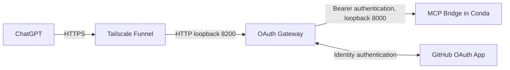

# macOS deployment through Tailscale Funnel

The main installation guide is [README](../README.en.md#macos-conda-and-tailscale-funnel)
([中文](../README.md#macosconda--tailscale-funnel)). This page covers the public
route and its operation. Machine-specific addresses, permissions and completed
checks belong in [deployment status](DEPLOYMENT_STATUS.md).



## Enable the route

After installing the MCP/Gateway and signing in to Tailscale, enable background
forwarding to the Gateway:

```bash
tailscale funnel --bg 8200
tailscale funnel status
```

Complete any approval requested by Tailscale. Use the HTTPS hostname reported by
Funnel as the public base; the ChatGPT connection URL is that base plus `/mcp`.
Keep the Mac powered on and connected. Funnel is independent of any existing
Cloudflare Named Tunnel and does not change its configuration.

## Match the OAuth URLs

Set `GATEWAY_PUBLIC_BASE` in `~/.config/ssh-mcp/github-oauth.env` to the Funnel
HTTPS base, without `/mcp`. The GitHub OAuth App homepage uses that same base;
its authorization callback is the base plus `/oauth/github/callback`.
Preserve existing credentials, token files, allowlists and the token database.
Restart Gateway after changing its environment:

```bash
launchctl kickstart -k "gui/$(id -u)/com.double.chatgpt-mcp-bridge.gateway"
```

In ChatGPT, choose OAuth with dynamic client registration, scopes `mcp` and
`offline_access`, and leave OIDC disabled. The Gateway supports persistent DCR,
PKCE S256, resource binding and rotating refresh tokens. A predefined public
client `chatgpt-mcp-bridge` with authentication method `none` is also supported.

## Verify and maintain

With `PUBLIC_BASE` set to the actual HTTPS base, check from an external network:

```bash
curl --fail --show-error "$PUBLIC_BASE/healthz"
curl --fail --show-error "$PUBLIC_BASE/.well-known/oauth-authorization-server"
curl --include "$PUBLIC_BASE/mcp"
```

Health and discovery should return 200; unauthenticated `/mcp` should return 401
with OAuth discovery information. Complete GitHub login in ChatGPT, then verify
an authenticated tool call. Discovery alone does not verify account linking.

For local MCP and native agent checks, run from the repository's Conda environment:

```bash
python deploy/doctor-mcp.py --probe-execute --probe-agent
```

Login startup and crash recovery are installed by
`deploy/install-macos-launchagents.py`. Logs are in
`~/Library/Logs/chatgpt-mcp-bridge/`; a stopped Mac or disconnected Tailscale
client cannot serve requests.
